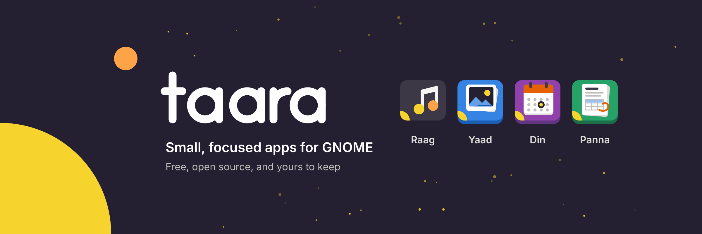

  

# Taara

Small, focused apps for the GNOME desktop. Free, open source, and they keep your files on your computer.

Every Taara app does one job well, follows the GNOME Human Interface Guidelines, works offline, and stores your data in standard files you can open anywhere.

## Apps

| | App | What it does | Status |
| --- | --- | --- | --- |
|  | [Raag](https://github.com/taara-apps/raag) | Play your music | In development |
|  | Din | Plan your days | In development |
|  | Yaad | Keep your photos close | Planned |
|  | Panna | Write, sketch and plan in one place | Planned |

## Get involved

- Found a bug or have an idea? Open an issue in the app's repository.
- Want to help build? Read the [contributing guide](https://github.com/taara-apps/.github/blob/main/CONTRIBUTING.md).
- Want to support the work? [Buy me a coffee on Ko-fi](https://ko-fi.com/taaraapps).
